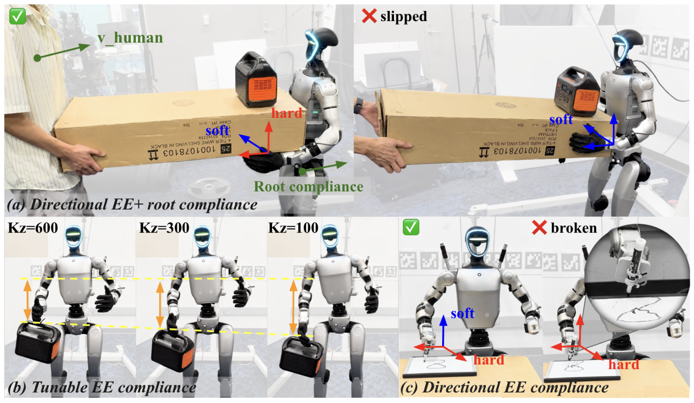
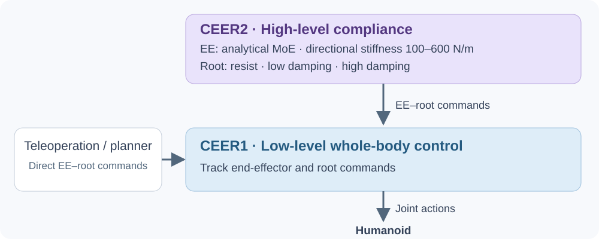

<h1 align="center">CEER</h1>
<p align="center"><strong>人形机器人全身控制与可调柔顺性</strong></p>
<p align="center">
  <a href="https://arxiv.org/abs/2605.19981">CEER1 arXiv</a> ·
  <a href="https://robotproject8.github.io/ceer_page/">CEER1 项目页</a> ·
  <a href="https://arxiv.org/abs/2609.38709">CEER2 arXiv</a> ·
  <a href="https://ee-root-compliance.github.io/">CEER2 项目页</a> ·
  <a href="https://ee-root-compliance.github.io/live-demo/"><strong>在线 Demo ↗</strong></a>
</p>
<p align="center"><a href="README.md">English</a> · 简体中文</p>

[](https://ee-root-compliance.github.io/)

<p align="center">方向柔顺 · 刚度调节 · 人机协作搬运</p>

## 控制框架

**CEER1** 将末端与根部指令转化为全身运动。

**CEER2** 在其上增加高层策略和解析 MoE，控制机器人受到外力时的响应。



CEER2 使用基于 CEER1 接口的冻结 stiff 底层策略。高层 expert 必须与训练时使用的底层 checkpoint 配套。

## 使用指南

| 功能 | 文档 |
|---|---|
| 在浏览器中体验柔顺控制 | [在线 Demo，无需安装](https://ee-root-compliance.github.io/live-demo/) |
| 安装 Isaac Lab 并准备动作数据 | [环境安装](docs/installation_zh.md) · [数据准备](docs/data_zh.md) |
| 训练底层柔顺控制策略 | [CEER1 / 柔顺训练](docs/ceer1_zh.md) |
| 添加末端方向柔顺和根部柔顺 | [CEER2 / 高层训练与 MoE](docs/ceer2_zh.md) |
| 交互式控制机器人 | [键盘遥操作与场景](docs/teleoperation_zh.md) |
| 评测刚度或比较 baseline | [评测指南](docs/evaluation_zh.md) |

## 快速开始

完成[环境安装](docs/installation_zh.md)和[数据准备](docs/data_zh.md)后，使用单张 GPU 检查训练流程：

```bash
CUDA_VISIBLE_DEVICES=0 python scripts/train.py \
  task=G1/G1_3kp_stiff +exp=train \
  wandb.mode=disabled task.num_envs=256 total_frames=40960
```

完整训练和评测前，请按照对应文档设置 W&B entity 和 checkpoint 路径。

<details>
<summary>代码入口</summary>

| 路径 | 用途 |
|---|---|
| `train.sh` | 底层 teacher → adapt → finetune |
| `train_hl_teacher_student.sh` | 高层 experts 与 baselines |
| `cfg/moe/` | 解析 MoE 的 expert 配置 |
| `scripts/eval_manipulation.py` | 交互控制与柔顺性评测 |
| `teleop_dummy_pub.py` | 键盘 / 动作位姿发送器 |
| `active_adaptation/` | 环境、策略与训练算法 |
| `docs/` | 中英文使用教程 |

</details>

## 相关研究

- **CEER（CEER1）：** [Compliant End-Effector and Root Control as a Unified Interface for Hierarchical Humanoid Loco-Manipulation](https://arxiv.org/abs/2605.19981)。
- **CEER2：** [Directional and Tunable End-Effector and Root Compliance for Humanoid Loco-Manipulation](https://arxiv.org/abs/2609.38709)。

## 致谢

本项目在 [GentleHumanoid](https://github.com/Axellwppr/gentle-humanoid-training) 开源代码的基础上开发，其实现为 CEER 底层控制器提供了起点。感谢原作者的开源贡献。

代码使用 [MIT License](LICENSE)。动作数据集遵循各自的原始许可证。[图片来源](docs/assets/README.md)。
